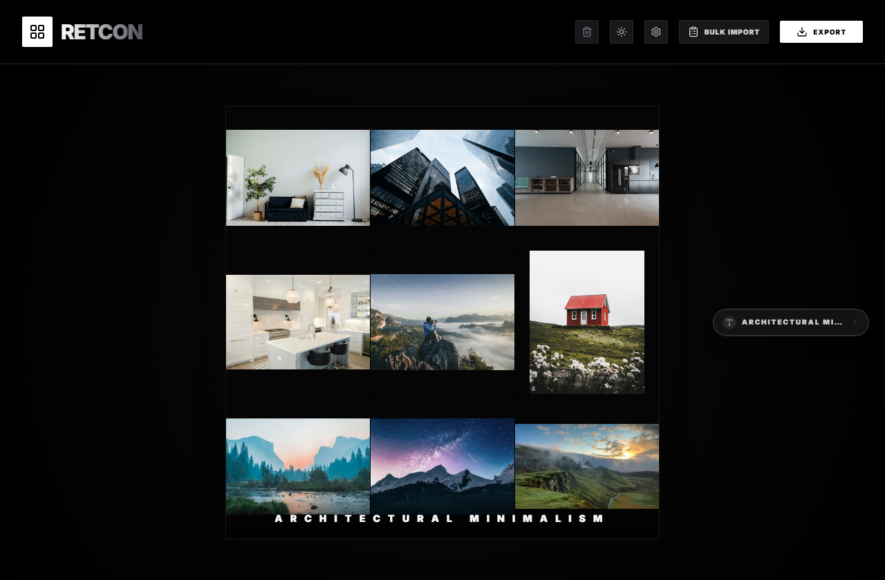
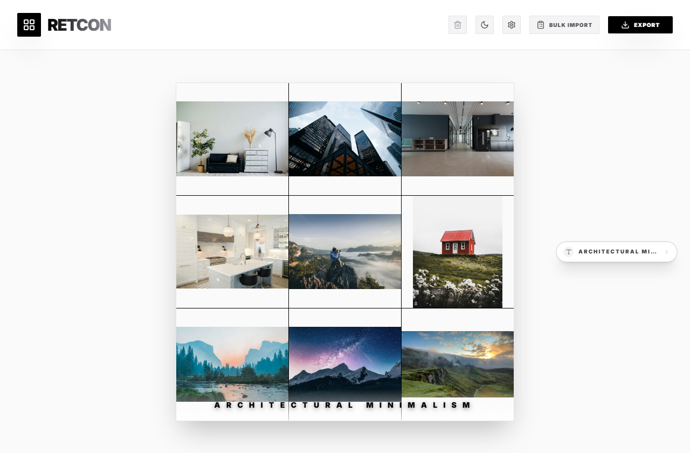
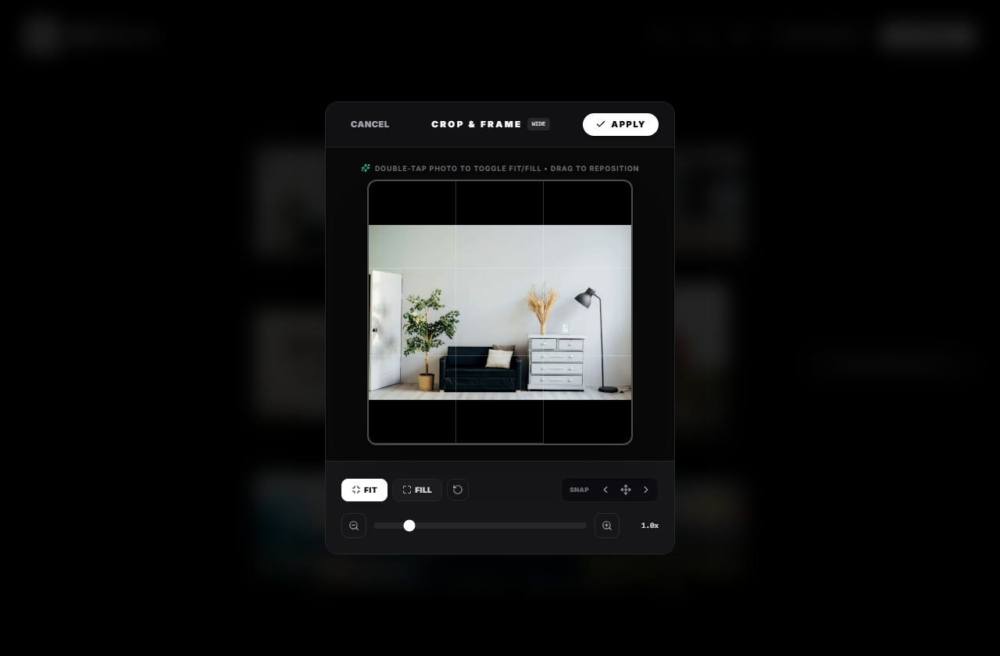

# RETCON 3x3

A minimalist, high-performance 3x3 grid and moodboard creator designed for designers, photographers, curators, and visual artists. Built with speed, precision framing, and high-resolution exports in mind.

[](https://react.dev/)
[](https://vitejs.dev/)
[](https://tailwindcss.com/)
[](https://www.docker.com/)
[](https://opensource.org/licenses/MIT)

---

## Showcase

### OLED Dark Mode Workspace


### Gallery Light Mode


### Gesture-First Crop & Frame Interface


---

## Key Features

### 📐 Gesture-First Precision Cropping
- **Double-Tap / Double-Click Snap**: Double-tap on mobile or double-click on desktop to instantly alternate between **Fit** (1.0x full view) and **Fill** (exact aspect-ratio coverage with 0 letterbox bars).
- **Smart Aspect-Ratio Detection**: Automatically measures image dimensions and calculates mathematically exact scales to eliminate black bars on any wide (16:9) or tall (9:16) photo.
- **Magnetic Pan & Boundary Clamping**: Prevents photos from ever sliding off-screen into empty space while providing tactile elastic feedback at edges.
- **1-Tap Contextual Directional Snaps**: Instantly snap vertical photos to **Top** (ideal for framing faces/heads) or horizontal photos to **Left** / **Right**.
- **Rule-of-Thirds Grid**: Dynamic visual guides illuminate during drags and pinches for precision compositional balance.

### 🏷️ Minimalist Floating Title Control
- **Side Pill Badge**: Replaced bulky centered headers with an unobtrusive floating side badge.
- **Expandable Card**: Tap to open a flyout with quick clear button and keyboard shortcuts (`Enter` / `Esc`).
- **Overlay On Grid Toggle**: Choose whether the title text is overlaid across the bottom of the exported grid or used strictly for clean file naming.

### 📥 Bulk Import & Direct Drag-and-Drop
- **Direct File Drop**: Drag and drop image files directly onto any individual tile from desktop folders.
- **Bulk Upload**: Select up to 9 local files at once with automatic client-side downsampling.
- **URL List Import**: Paste a list of remote image URLs to populate the grid in one click.
- **Tile Swapping**: Drag tiles on desktop or long-press on touchscreens to reorder positions seamlessly.

### 💾 High-Resolution Multi-Format Export
- **Formats**: Export pristine compositions in **PNG**, **JPEG**, or **WebP**.
- **Configurable Naming Schemes**: `DEFAULT`, `TIMESTAMP`, `MINIMAL`, or `CHRONO`.
- **iOS Safari / WebKit Memory Guard**: Automatically clamps rendering dimensions and surface area ($\le 16.7\text{M pixels}$) to protect mobile devices from out-of-memory crashes.

### ⚡ Offline & Storage Architecture
- **IndexedDB Auto-Persistence**: Full composition state, tile offsets, scale transforms, and theme preferences are saved locally and restored instantly across sessions.
- **Local Tailwind Pipeline**: 100% offline-ready with zero external CSS runtime dependencies.
- **Smart Image Downsampling**: Scales 12MP–48MP smartphone uploads to $\le 2560\text{px}$ before storing to keep browser memory lightweight.
- **CORS Proxy Integration**: Integrated proxying via `weserv.nl` allows seamless inclusion of external image URLs without tainted canvas export failures.

---

## Getting Started

### Local Development

#### Prerequisites
- **Node.js**: v22 or higher recommended
- **npm**: v10 or higher

#### Quick Start
```bash
# 1. Clone repository
git clone https://github.com/OwlSoda/RETCON-3x3.git
cd RETCON-3x3

# 2. Install dependencies
npm install

# 3. Start local development server
npm run dev
```
Open [http://localhost:3000](http://localhost:3000) in your browser. If you run the Vite dev server behind a custom domain, set `VITE_ALLOWED_HOSTS=your.domain.com` (comma-separated, or `true` to allow all hosts).

```bash
# Run unit tests
npm test

# Build for production
npm run build

# Preview production build
npm run preview
```

---

## Docker Deployment

RETCON 3x3 ships as a lightweight multi-stage Docker image (`linux/amd64` and `linux/arm64`) served by Nginx Alpine with SPA routing, gzip compression, security headers, and a `/health` endpoint.

### Quick Start (Prebuilt GHCR Image)
The default `docker-compose.yml` pulls the latest image directly from GitHub Container Registry:

```bash
# Start container in background
docker compose up -d

# Pull updates and restart
docker compose pull && docker compose up -d
```

By default, the app is exposed on port `7826` (`http://localhost:7826`). Override the host port with `RETCON_PORT`:

```bash
RETCON_PORT=8080 docker compose up -d
```

### Build Locally from Source
If you want to build the Docker image locally instead of pulling from GHCR:

```bash
docker compose -f docker-compose.yml -f docker-compose.build.yml up -d --build
```

### Stop Container
```bash
docker compose down
```

### Self-Hosting & Privacy Notes
- **Reverse Proxy Ready**: The container serves plain HTTP on port `80` and includes hardened headers (`Content-Security-Policy`, `X-Content-Type-Options`, `X-Frame-Options`, `Referrer-Policy`, `Permissions-Policy`) with no hardcoded hostnames — point Nginx, Caddy, Traefik, or Cloudflare Tunnel directly at the container port.
- **Local vs. External Images**: Locally uploaded files stay 100% in your browser (IndexedDB). External image URLs pasted into tiles are loaded with `no-referrer` via [`images.weserv.nl`](https://images.weserv.nl/) to bypass cross-origin canvas export restrictions.

---

## Technical Stack

| Layer | Technology |
| :--- | :--- |
| **Framework** | [React 19](https://react.dev/) |
| **Build Tool** | [Vite 6](https://vitejs.dev/) |
| **Styling** | [Tailwind CSS 3.4](https://tailwindcss.com/) + [PostCSS](https://postcss.org/) |
| **Icons** | [Lucide React](https://lucide.dev/) |
| **Canvas Export** | [HTML-to-Image](https://github.com/bubkoo/html-to-image) |
| **Persistence** | Browser IndexedDB API |
| **Container** | Docker + [Nginx Alpine](https://hub.docker.com/_/nginx) |

---

## License

This project is licensed under the MIT License — see the [LICENSE](LICENSE) file for details.
